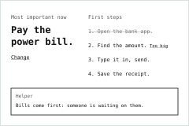

  

# Focus

  

Didn't work? Create a Studio workspace and paste this to your agent:
` /use-template https://github.com/boweiliu/focus-template`

## Why you care

One screen with the single most important thing to work on now and its first small steps, with a Claude helper that picks it and breaks it down.

People who procrastinate stall on a long list because choosing is the hard part. Focus makes the choice for you and shows only one thing and one next step, so starting is easy.

## How to use it

Open **Focus** from the desktop.

1. **Choose.** Open "Choose one thing", type what is on your mind (rent, a long overdue email, laundry) and press "Help me choose". The helper asks at most two short questions, then proposes one thing and three to five tiny first steps, with a sentence on why it comes first.
2. **Edit and save.** Change any words, add a step, or press "Make steps smaller". Save makes it the current focus.
3. **Work the list.** The main screen shows the one thing and its steps. Click a step to cross it out. Next to the first open step, "Too big" asks the helper to break it into two to four smaller steps, shown under it.
4. **Look back.** "Before" on the Setup screen lists past focuses, each with the saved helper conversation and the model's exact answers.

Everything is kept as JSON in `data/.apps/focus/`; it needs no account and no key, only the workspace's Claude sign-in.

## Ideas for making it yours

- Change the helper's voice: rewrite the prompts in `helper.py` for a gentler, more playful or more blunt tone.
- Give the steps a time box: have the helper add a minutes estimate to each step and show it on the main screen.
- Add a "come back to it" nudge: a routine that opens Focus at a set hour and shows the current step.
- Let a second person see your focus: add a read-only share link for a friend who keeps you accountable.
- Use a smaller or cheaper model for splitting steps and keep the larger one for choosing.

## What this is

This repository is a published **Imbue Studio template**: a clean, bootable
snapshot of what an agent built, ready to adapt into your own. It is NOT the
generic workspace template -- it is this specific project.

[`template.md`](template.md) is the full manifest -- what it is, how it
works, what it needs to run, and what to adapt -- with the
machine-readable half (recipe, requirements, and the environment it needs
installed) in [`template.toml`](template.toml).
